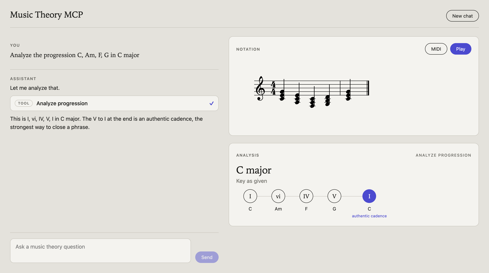
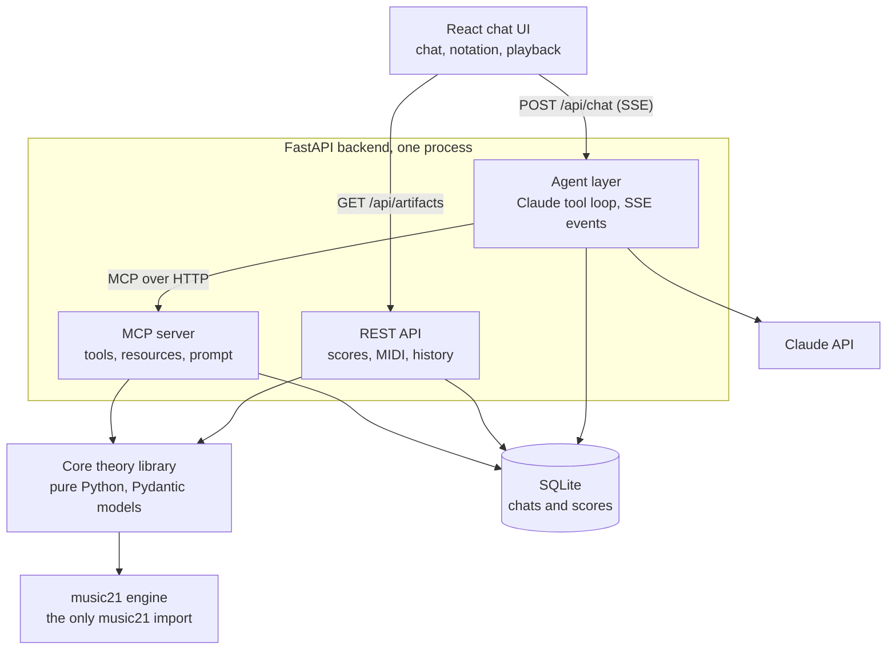

# Music Theory MCP

Chat with an AI that runs real music theory tools, with live notation and playback beside the chat.

Claude decides which tool to call, the tools compute the answer with [music21](https://github.com/cuthbertLab/music21), and the score appears in the sheet-music panel. The theory logic lives once, in a typed core library, and is exposed through an MCP server that the chat agent uses like any other MCP client.



## What it does

- **Chat** with streaming replies and collapsible tool-call cards.
- **Notation panel** rendered from MusicXML, with playback and MIDI download.
- **Six theory tools:** identify a chord, look up a scale, detect the scale from notes, name an interval, transpose, and analyze a progression (key, Roman numerals, cadences).
- **Follow-ups work.** "Transpose that up a fourth" transposes the score already on screen.

## Run it

You need an Anthropic API key. Copy `.env.example` to `.env` and put the key in it.

**With Docker:**

```bash
docker compose up --build
```

Then open http://localhost:8000.

**Without Docker** (needs [uv](https://docs.astral.sh/uv/) and Node 22):

```bash
uv sync
cd web && npm install && npm run build && cd ..
uv run --env-file .env uvicorn server.api.main:app --port 8000
```

For frontend development, run `npm run dev` in `web/` and open http://localhost:5173. It proxies API calls to the backend on port 8000.

**As an MCP server in Claude Desktop**, add this to its config:

```json
{
  "mcpServers": {
    "music-theory": {
      "command": "uv",
      "args": ["--directory", "/path/to/this/repo", "run", "python", "-m", "server.mcp_server"]
    }
  }
}
```

## Architecture



| Layer | Where | Job |
|---|---|---|
| Core | `core/services`, `core/models` | All theory logic, once. Typed models in and out. |
| Engine | `core/engine` | The only code that imports music21. Converts to and from plain values. |
| MCP server | `server/mcp_server.py` | Exposes the core as tools. Validates input and turns errors into readable tool errors. |
| Agent | `server/agent` | The Claude tool loop. An MCP client that streams typed events. |
| REST API | `server/api` | Serves scores, MIDI and chat history. A second adapter over the same core. |
| Store | `server/store` | SQLite through SQLAlchemy: chat messages and rendered scores. |
| Web | `web` | React and TypeScript, OpenSheetMusicDisplay for notation, Tone.js for sound. |

### Three rules, enforced in CI

[import-linter](https://import-linter.readthedocs.io/) checks these on every push (see `pyproject.toml`):

1. **`core` never imports `server`.** Dependencies point inward.
2. **Only `core/engine` imports music21.** The heavy dependency is contained, and could be swapped.
3. **`server/agent` never imports `core`.** The agent reaches theory only through MCP, so the MCP server is the real boundary and not a demo on the side.

## Design decisions

**Two payloads per tool result.** Every tool returns a compact `summary` (chord names, Roman numerals) and an `artifact` id. The MusicXML is saved in SQLite and fetched by the browser. It never enters Claude's context, which saves tokens and latency. A test asserts this.

**Score handles for follow-ups.** The artifact id doubles as a handle. `transpose` accepts a `score_id`, so Claude can transpose a whole earlier score without resending its notes.

**A typed event protocol.** The agent streams six server-sent events, defined as Pydantic models in `server/agent/events.py` and mirrored in `web/src/types.ts`:

| Event | Carries |
|---|---|
| `text_delta` | A chunk of Claude's reply |
| `tool_call` | Tool name and inputs, for the tool card |
| `tool_result` | The compact summary, or the error message |
| `artifact` | The id of a score for the notation panel |
| `error` | A message and whether the chat can carry on |
| `done` | End of turn, with token usage |

**Agent loop safeguards.**

- A cap on tool rounds per turn (`MTM_MAX_TOOL_ROUNDS`).
- A timeout on every tool call (`MTM_TOOL_TIMEOUT`), because music21 can be slow.
- Tool errors go back to Claude as readable text, so it can fix its input and retry.
- Model, effort and limits come from environment variables.
- Chat history is append-only, and replies are stored exactly as Claude sent them.

**Errors that fail loudly at the boundary.** The core raises `TheoryError` subclasses. The MCP server converts them into tool errors such as `InvalidNoteError: 'banana' is not a valid note`.

**Scale detection is a scored ranking.** Each of 132 candidate scales gets a weighted score from four kinds of evidence: how many of the notes fit, how much of the scale is used, signs of the home note, and how common the scale is. The weights are named constants in `core/services/scales.py`. They are a judgment call, not a published method.

**Kept simple on purpose.** One process, SQLite, no queues, no vector database. SQLAlchemy keeps a move to Postgres small if it is ever needed.

## Tests

```bash
uv run pytest          # 204 tests
uv run ruff check .
uv run lint-imports    # the three architecture rules
```

- **Core:** golden cases for every tool, plus round-trip properties such as "transpose up then down returns the original".
- **MCP server:** called through a real MCP client, in memory.
- **Agent:** run against a scripted stand-in for the Claude API, covering the round cap, timeouts, tool-error recovery, parallel tool calls and API failures.
- **REST API:** the full chat stream, score download, MIDI export and saved history.

## Limits

- Chords: triads, seventh chords, sus2 and sus4. Ninths and other extensions are not named.
- Cadences are read from neighbouring chords. There is no rhythm, so phrase endings are a guess.
- Scale detection sees only notes. It does not know that a dominant seventh points to a key.
- Scores are drawn as plain quarter notes in 4/4.

## What comes next

- A tool-selection eval harness that runs in CI and reports an accuracy number.
- A Carnatic layer: melakarta and janya ragas, swara-to-pitch mapping, closest-raga lookup.
- Hypothesis property tests and wider golden coverage.
- A per-turn trace of tools, latency and token use.
- Voice-leading checks and melody harmonization.
